# Architecture — Lunar Crater Classification (Classical CV + SVM)

> A fully classical computer-vision system that converts a YOLO object-detection
> dataset of Moon/Mars imagery into a binary **crater / non-crater** patch
> classifier (HOG + Linear SVM), and then re-uses that patch classifier as the
> verification stage of a full-image crater detector (Hough circles + sliding
> window + NMS), all exposed through a Streamlit dashboard.
>
> **No deep learning is used anywhere.** The `best.pt` file shipped with the
> original archive is deliberately ignored.

---

## Table of contents

1. [Design goals and constraints](#1-design-goals-and-constraints)
2. [System overview](#2-system-overview)
3. [Component inventory](#3-component-inventory)
4. [Module dependency graph](#4-module-dependency-graph)
5. [Stage 1 — Dataset construction](#5-stage-1--dataset-construction-prepare_datasetpy)
6. [Stage 2 — Preprocessing and feature extraction](#6-stage-2--preprocessing-and-feature-extraction-featurespy)
7. [Stage 3 — Training and evaluation](#7-stage-3--training-and-evaluation-trainpy)
8. [Stage 4 — Ablation experiments](#8-stage-4--ablation-experiments-experimentpy)
9. [Stage 5 — Inference application](#9-stage-5--inference-application-apppy)
10. [Full-image detection architecture](#10-full-image-detection-architecture)
11. [Data contracts and shapes](#11-data-contracts-and-shapes)
12. [Runtime characteristics](#12-runtime-characteristics)
13. [Directory layout](#13-directory-layout)
14. [End-to-end execution runbook](#14-end-to-end-execution-runbook)
15. [Design decisions and rationale](#15-design-decisions-and-rationale)
16. [Known limitations and caveats](#16-known-limitations-and-caveats)
17. [Extension points](#17-extension-points)

---

## 1. Design goals and constraints

| Goal | How the architecture satisfies it |
| --- | --- |
| Demonstrate a *classical* CV pipeline end to end | Every stage is explicit and hand-written: annotation parsing, ROI extraction, negative mining, contrast enhancement, smoothing, handcrafted descriptors, linear classifier |
| No pretrained deep model | Dependencies are limited to OpenCV, scikit-image, scikit-learn, NumPy, Matplotlib, joblib, Streamlit |
| Avoid train/test leakage | Patches inherit the split of the 640x640 source image they were cropped from; a source image never contributes to two splits |
| Make preprocessing contribution measurable | Preprocessing is parameterised (`use_clahe`, `use_blur`) and feature type is pluggable (`hog`, `lbp`, `hog_lbp`), so the four-way ablation is a config list, not four code paths |
| Reproducibility | Fixed `RANDOM_SEED = 42` for negative sampling, `random_state=42` for the SVM, deterministic directory iteration via `sorted()` |
| Lunar-only scope | Filename-based filter drops any file containing `mars_crater` |

---

## 2. System overview

The project is a **three-phase batch + serve architecture**: an offline data
preparation phase, an offline training/evaluation phase, and an interactive
serving phase. Phases communicate only through the filesystem — there is no
database, no network service, and no shared in-memory state.

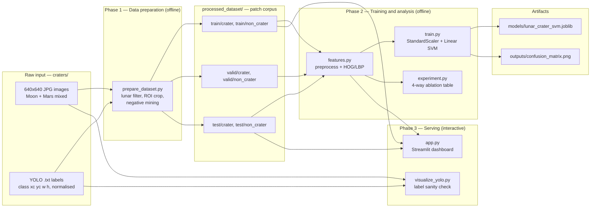

### Layered view

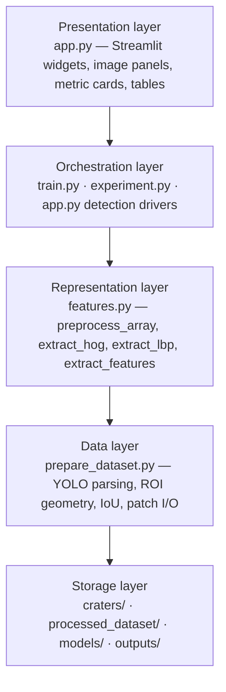

---

## 3. Component inventory

| File | Role | Key public surface | Inputs | Outputs |
| --- | --- | --- | --- | --- |
| `prepare_dataset.py` | Dataset builder / ETL | `main`, `prepare_split`, `yolo_to_box`, `square_with_padding`, `iou`, `crop_and_resize`, `is_lunar_file` | `craters/<split>/{images,labels}` | `processed_dataset/<split>/{crater,non_crater}/*.png` |
| `features.py` | Shared representation module (single source of truth for preprocessing) | `preprocess_array`, `preprocess_image`, `extract_hog`, `extract_lbp`, `extract_features` | patch path or NumPy array | 1-D float feature vector |
| `train.py` | Reference training + evaluation run | `main`, `load_split` | `processed_dataset/` | `models/lunar_crater_svm.joblib`, `outputs/confusion_matrix.png`, stdout reports |
| `experiment.py` | Ablation harness | `main`, `evaluate`, `load_split` | `processed_dataset/` | stdout metric table (accuracy, precision, recall, F1) |
| `app.py` | Streamlit dashboard: patch inspector + full-image detector | module-level script, ~20 helper functions | `processed_dataset/`, `craters/test/`, user upload | rendered UI, overlays, detection tables |
| `visualize_yolo.py` | Annotation sanity checker | `main(image_path, label_path)` | one image + one label file | `outputs/annotated_sample.jpg` |
| `requirements.txt` | Dependency manifest | — | — | opencv-python, numpy, scikit-image, scikit-learn, matplotlib, joblib |

Note: `requirements.txt` does **not** list `streamlit`, which `app.py` needs —
see [limitations](#16-known-limitations-and-caveats).

---

## 4. Module dependency graph

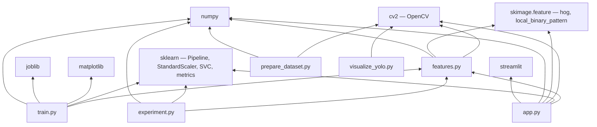

`features.py` is the architectural keystone: `train.py`, `experiment.py` and
`app.py` all import it, which guarantees that the preprocessing applied at
training time is bit-identical to the preprocessing applied at inference time.
`prepare_dataset.py` is intentionally decoupled — it only performs geometry and
I/O, never feature extraction.

---

## 5. Stage 1 — Dataset construction (`prepare_dataset.py`)

### 5.1 Problem

The source archive is an **object-detection** dataset (YOLO format), but the
project needs a **binary classification** dataset. There are also two planetary
bodies mixed into one folder tree. Stage 1 solves both: it transcodes detection
annotations into labelled image patches and discards Martian imagery.

### 5.2 Flow

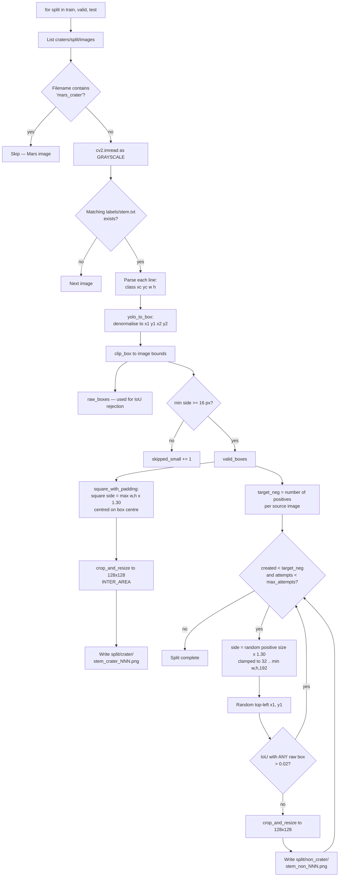

### 5.3 ROI geometry

Positives are not cropped at the raw annotation rectangle. `square_with_padding`
converts each box into a **square** centred on the annotation centre, with side

```
side = max(box_width, box_height) * (1 + 2 * POSITIVE_PADDING)   # 1.30x
side = max(side, MIN_CRATER_SIDE)                                # >= 16 px
```

then clips to the image. Two reasons:

1. **Squareness** preserves aspect ratio under the later resize to 128x128, so
   HOG gradient orientations are not sheared by anisotropic scaling.
2. **15% padding on each side** keeps the crater *rim and shadow* inside the
   patch. The rim-shadow gradient pair is the single most discriminative cue for
   a HOG descriptor; cropping tight to the annotation would clip it away.

```
         annotation box                 square_with_padding
    ┌───────────────────┐          ┌─────────────────────────┐
    │ ░░░░░░░░░░░░░░░░░ │          │                         │
    │ ░░░   crater  ░░░ │   ───▶   │   ┌───────────────┐     │  side = 1.30 x max(w,h)
    │ ░░░░░░░░░░░░░░░░░ │          │   │ ░░░ crater ░░ │     │  centre preserved
    └───────────────────┘          │   └───────────────┘     │  rim + shadow retained
                                   └─────────────────────────┘
```

### 5.4 Negative mining strategy

Negatives are mined **from the same source image** as the positives, which is a
deliberate choice: it forces the classifier to separate craters from the
*surrounding terrain of the same scene* (same illumination angle, same sensor
noise, same albedo) rather than learning a trivial image-level shortcut.

Three guards keep negatives honest:

| Guard | Constant | Purpose |
| --- | --- | --- |
| Overlap rejection | `NEGATIVE_IOU_LIMIT = 0.02` | A candidate is rejected if it overlaps *any* raw annotation (including boxes dropped for being tiny) by more than 2% IoU — so "non-crater" never silently contains a crater |
| Scale matching | `side = chosen positive size * 1.30` | Negative patches occupy a similar pixel footprint to positives, so patch scale is not a label-leaking feature |
| Attempt budget | `max_attempts = max(300, target_neg * 120)` | Bounds the rejection-sampling loop on crater-dense images where free terrain is scarce |

Class balance is enforced per source image (`target_neg = len(positive_sizes)`),
which produces an exactly balanced corpus whenever the attempt budget is not
exhausted. On the dataset currently on disk it is never exhausted:

| Split | Source images | Lunar images kept | Crater patches | Non-crater patches |
| --- | --- | --- | --- | --- |
| `train` | 98 | 16 | 267 | 267 |
| `valid` | 26 | 4 | 49 | 49 |
| `test` | 19 | 4 | 56 | 56 |
| **Total** | **143** | **24** | **372** | **372** |

So 24 lunar source images expand into 744 labelled 128x128 patches — roughly a
31x amplification, which is what makes a classical pipeline viable on such a
small image budget.

### 5.5 Leakage control

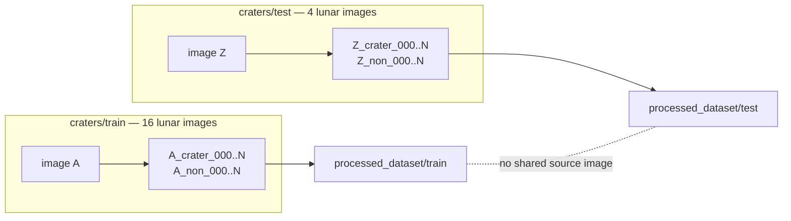

The split boundary is the **source image**, not the patch. Because patches from
one 640x640 scene are highly correlated (shared terrain, lighting, compression
artefacts), splitting at patch level would inflate test accuracy badly. The
patch filename carries the source stem (`<source_stem>_crater_003.png`), which
also lets `app.py` reconstruct the provenance link back to the original scene.

### 5.6 Idempotency

`main()` calls `shutil.rmtree(output_root)` before regenerating, so the stage is
destructive-but-idempotent: the same source tree and seed always produce the
same patch corpus, and stale patches from an earlier run can never leak into a
new one.

---

## 6. Stage 2 — Preprocessing and feature extraction (`features.py`)

### 6.1 Pipeline

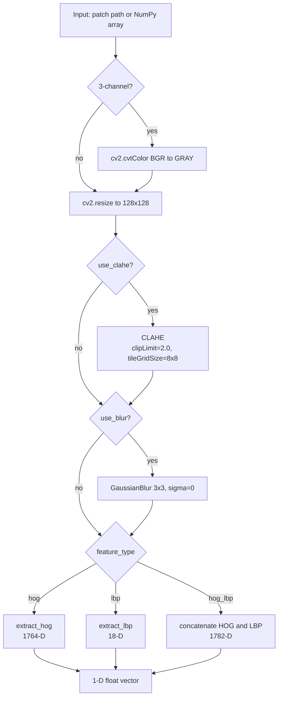

### 6.2 Why each operator is there

**CLAHE (Contrast Limited Adaptive Histogram Equalisation)** — Lunar optical
imagery has extreme local dynamic range: a sun-facing rim can be saturated while
the crater floor sits in near-black shadow. Global histogram equalisation would
amplify noise in the flat mare regions. CLAHE equalises within 8x8 tiles and
clips the histogram at 2.0 before redistributing, which lifts rim/shadow
structure in shadowed craters without blowing out the already-bright terrain.
This is the operator that makes dim craters detectable at all.

**Gaussian blur 3x3** — HOG differentiates the image, and differentiation
amplifies high-frequency noise. CLAHE has just *increased* that noise. A small
3x3 kernel suppresses JPEG blocking artefacts and sensor grain while leaving the
crater-scale (tens of pixels) rim gradients intact. Kernel size is kept minimal
precisely so real rim edges are not smeared.

**HOG** — A crater's signature is a *geometric arrangement of gradients*: a
bright-to-dark transition on the sun side and dark-to-bright on the anti-sun
side, arranged around a roughly circular contour. HOG encodes exactly that —
local gradient-orientation histograms, block-normalised — and is invariant to
the absolute brightness that varies across the scene.

**LBP (optional)** — HOG is blind to fine texture that carries no strong
gradient direction. LBP with radius 2 / 16 points in `uniform` mode produces an
18-bin rotation-invariant micro-texture histogram, capturing regolith roughness
versus the smooth interior of a degraded crater. It is appended as an extra 18
dimensions in the `hog_lbp` configuration.

### 6.3 HOG dimensionality derivation

```
image            128 x 128
pixels_per_cell   16 x 16    ->  8 x 8 = 64 cells
cells_per_block    2 x 2     ->  (8-2+1) x (8-2+1) = 7 x 7 = 49 blocks
orientations       9         ->  2 x 2 x 9 = 36 values per block
feature length    49 x 36    =  1764
```

Verified against the trained artifact: `StandardScaler.n_features_in_ == 1764`.

| `feature_type` | Composition | Dimensions |
| --- | --- | --- |
| `hog` | HOG only | 1764 |
| `lbp` | LBP uniform histogram, L1-normalised | 18 |
| `hog_lbp` | `concat(HOG, LBP)` | 1782 |

### 6.4 Parameter reference

| Parameter | Value | Where |
| --- | --- | --- |
| `IMG_SIZE` | `(128, 128)` | `features.py` |
| CLAHE `clipLimit` | `2.0` | `preprocess_array` |
| CLAHE `tileGridSize` | `(8, 8)` | `preprocess_array` |
| Gaussian kernel | `(3, 3)`, sigma auto | `preprocess_array` |
| HOG `orientations` | `9` | `extract_hog` |
| HOG `pixels_per_cell` | `(16, 16)` | `extract_hog` |
| HOG `cells_per_block` | `(2, 2)` | `extract_hog` |
| HOG `block_norm` | `L2-Hys` | `extract_hog` |
| LBP `radius` | `2` | `extract_lbp` |
| LBP `n_points` | `16` (= 8 x radius) | `extract_lbp` |
| LBP `method` | `uniform` | `extract_lbp` |
| LBP bins | `18` (= n_points + 2) | `extract_lbp` |

### 6.5 Dual entry points

`preprocess_image(path, ...)` reads from disk; `preprocess_array(array, ...)`
accepts an in-memory array. This split is what lets the *same* preprocessing
serve two very different callers: batch training over files, and per-window
inference inside the sliding-window detector where no file exists.

---

## 7. Stage 3 — Training and evaluation (`train.py`)

### 7.1 Configuration block

```python
DATA_ROOT    = Path('processed_dataset')
FEATURE_TYPE = 'hog'
USE_CLAHE    = True
USE_BLUR     = True
MODEL_PATH   = Path('models/lunar_crater_svm.joblib')
CM_PATH      = Path('outputs/confusion_matrix.png')
```

### 7.2 Sequence

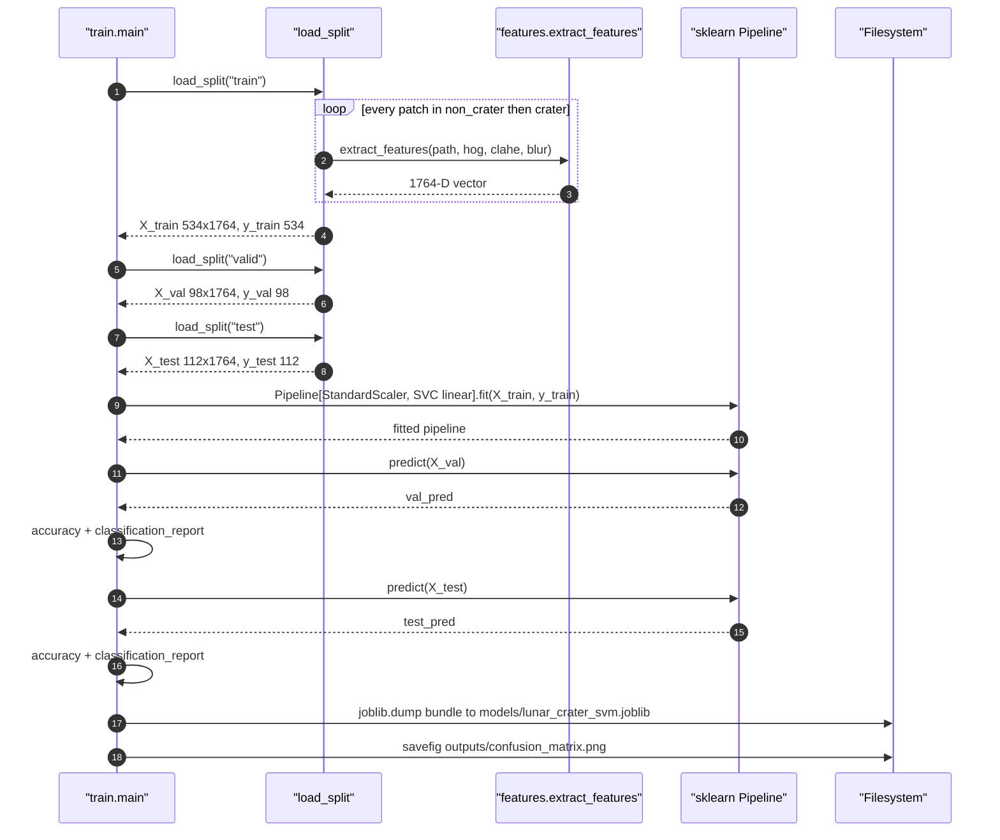

### 7.3 Label convention

`load_split` iterates `[('non_crater', 0), ('crater', 1)]`, so:

| Class id | Directory | Report name |
| --- | --- | --- |
| `0` | `non_crater/` | `Non-crater` |
| `1` | `crater/` | `Crater` |

Class `1` is the positive class, which is what makes the binary precision /
recall / F1 in `experiment.py` refer to crater detection.

### 7.4 Estimator

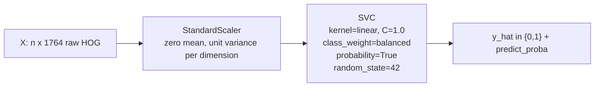

| Choice | Rationale |
| --- | --- |
| `StandardScaler` | HOG block norms are bounded but unevenly scaled across the 1764 dimensions; an unscaled linear SVM lets high-variance dimensions dominate the margin |
| `kernel='linear'` | Keeps the project aligned with the canonical HOG+SVM detection literature, stays interpretable (one weight per HOG bin), and avoids overfitting 1764 dimensions with only 534 training samples |
| `C=1.0` | Default regularisation strength; with p >> n a soft margin is essential |
| `class_weight='balanced'` | Defensive — the corpus is balanced by construction, but this keeps the model correct if the negative-sampling budget is ever exhausted on crater-dense images |
| `probability=True` | Required downstream: the detector thresholds `predict_proba` and NMS ranks by confidence. Costs an internal Platt-scaling cross-validation at fit time |
| `Pipeline` | Scaler statistics are fitted on train only and travel with the model inside the joblib bundle, so inference cannot accidentally re-fit or skip scaling |

### 7.5 Persisted artifact

`joblib.dump` writes a **self-describing bundle**, not a bare estimator:

```python
{
    'model':        Pipeline(StandardScaler, SVC),
    'feature_type': 'hog',
    'use_clahe':    True,
    'use_blur':     True,
}
```

This is the project's key serving-correctness mechanism: the preprocessing
configuration is stored *with* the weights, so a consumer cannot feed a model
trained on `CLAHE + blur + HOG` with features computed some other way.

Current artifact on disk (`models/lunar_crater_svm.joblib`, ~2.5 MB):

| Property | Value |
| --- | --- |
| Input dimensionality | 1764 |
| Classes | `[0, 1]` |
| Support vectors | 105 for class 0, 69 for class 1 (174 total of 534 training samples) |
| Stored preprocessing | `feature_type='hog'`, `use_clahe=True`, `use_blur=True` |

### 7.6 Evaluation outputs

- `classification_report` on **valid** — used for sanity checking and any manual
  tuning decisions.
- `classification_report` on **test** — the headline result, reported once.
- `outputs/confusion_matrix.png` — `ConfusionMatrixDisplay` over the test split
  at 200 dpi, integer cell formatting.

The valid split exists specifically so that threshold or parameter choices never
touch `test`; `train.py` itself does not tune anything, so `valid` is currently
an honest held-out observer.

---

## 8. Stage 4 — Ablation experiments (`experiment.py`)

### 8.1 Design

The ablation adds one operator at a time, so each row isolates the marginal
contribution of a single preprocessing or representation choice.

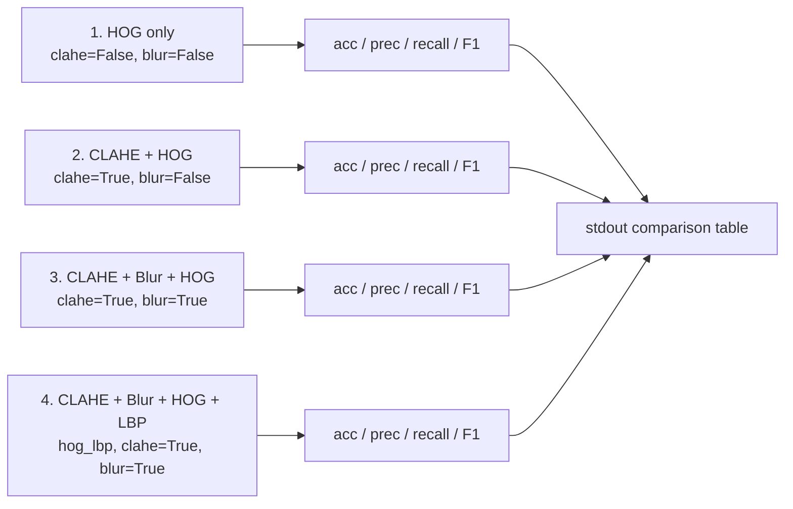

| # | Configuration | `feature_type` | `use_clahe` | `use_blur` | Isolates |
| --- | --- | --- | --- | --- | --- |
| 1 | HOG only | `hog` | `False` | `False` | Baseline descriptor power |
| 2 | CLAHE + HOG | `hog` | `True` | `False` | Gain from local contrast enhancement |
| 3 | CLAHE + Blur + HOG | `hog` | `True` | `True` | Gain from noise suppression before differentiation |
| 4 | CLAHE + Blur + HOG + LBP | `hog_lbp` | `True` | `True` | Gain from adding micro-texture to shape |

Each row re-extracts features from disk and fits a **fresh** pipeline
(`StandardScaler` + `SVC(linear, C=1.0, class_weight='balanced')`), so rows are
fully independent. Note that `experiment.py` deliberately omits
`probability=True` — it only needs hard labels, and skipping Platt scaling makes
the 4-way sweep noticeably faster.

### 8.2 Metrics

`precision_recall_fscore_support(..., average='binary', zero_division=0)` with
class `1` (crater) as positive, plus `accuracy_score`. Reported to 4 decimals.

- **Recall** answers "what fraction of real craters did we find?" — the operative
  metric for a survey tool.
- **Precision** answers "how much of what we flagged is actually a crater?" — the
  operative metric for downstream manual review cost.

### 8.3 Scope difference versus `train.py`

`experiment.py` trains on `train` and scores on `test` only — it never loads
`valid`. It also persists nothing. It is a reporting harness, not a model
producer; `train.py` remains the only path that writes `models/`.

---

## 9. Stage 5 — Inference application (`app.py`)

### 9.1 Startup and guard rails

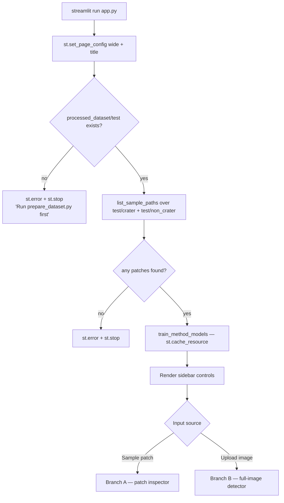

### 9.2 In-app model farm

`app.py` does **not** load `models/lunar_crater_svm.joblib`. Instead,
`train_method_models()` trains all four ablation configurations at startup and
caches them for the lifetime of the Streamlit process via `@st.cache_resource`:

```python
models = {
    "HOG only":                 {"model": Pipeline, "feature_type": "hog",     "use_clahe": False, "use_blur": False, "test_accuracy": float},
    "CLAHE + HOG":              {"model": Pipeline, "feature_type": "hog",     "use_clahe": True,  "use_blur": False, "test_accuracy": float},
    "CLAHE + Blur + HOG":       {"model": Pipeline, "feature_type": "hog",     "use_clahe": True,  "use_blur": True,  "test_accuracy": float},
    "CLAHE + Blur + HOG + LBP": {"model": Pipeline, "feature_type": "hog_lbp", "use_clahe": True,  "use_blur": True,  "test_accuracy": float},
}
```

Each entry is a **model bundle** with the same self-describing shape as the
joblib artifact plus a `test_accuracy` field, so any helper that receives a
bundle can reconstruct the exact matching feature pipeline. This is why the
dashboard can show four side-by-side methods without any configuration drift.

The cost of this design is a one-time cold start: four feature extractions over
the full train+test corpus plus four `probability=True` SVM fits before the
first frame renders. The benefit is that the dashboard is a live comparison tool
rather than a single-model viewer.

### 9.3 Branch A — sample patch inspector

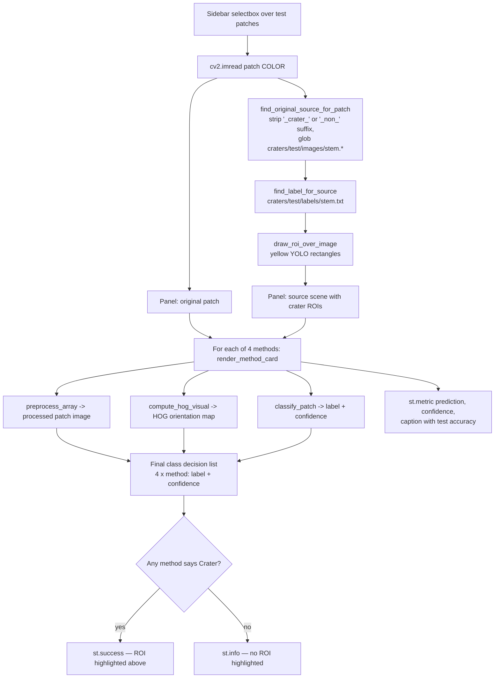

This branch is the pedagogical core: for a single patch it shows the *same input*
transformed four different ways, the HOG gradient map that the SVM actually
consumes, and the four independent verdicts — making the ablation visual rather
than tabular.

**Provenance recovery.** `find_original_source_for_patch` exploits the naming
convention established in Stage 1. Given `Z_crater_003.png` it splits on
`_crater_` (or `_non_`) to recover the stem `Z`, globs `craters/test/images/Z.*`,
and falls back to a `startswith` scan if the glob misses. This round-trip from
patch back to 640x640 scene is what allows the ROI overlay.

**HOG visualisation.** `compute_hog_visual` re-runs `skimage.hog` with
`visualize=True, feature_vector=False` purely for display, then min-max
normalises to `uint8`. The displayed map is *not* the vector fed to the SVM
(different flattening flags), but it is computed from the identical preprocessed
image, so it faithfully shows which gradients drive the decision.

### 9.4 Branch B — upload and detect

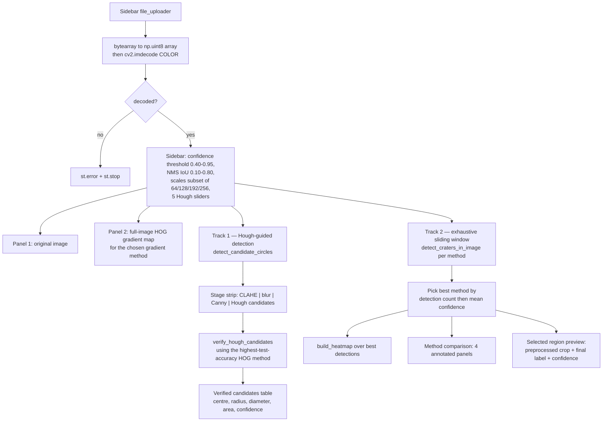

The upload branch runs **two independent detection strategies** over the same
image and reports both — a cheap geometry-primed track and an exhaustive
brute-force track. Section 10 details them.

### 9.5 Sidebar control surface

| Control | Type | Range / options | Default | Consumed by |
| --- | --- | --- | --- | --- |
| Input source | radio | Sample patch / Upload image | Sample patch | branch selection |
| Sample patch | selectbox | all `processed_dataset/test` patches | first | Branch A |
| Upload lunar image | file_uploader | png, jpg, jpeg, bmp, tif, tiff | — | Branch B |
| Confidence threshold | slider | 0.40 – 0.95, step 0.01 | 0.60 | both detection tracks |
| NMS IoU threshold | slider | 0.10 – 0.80, step 0.05 | 0.30 | sliding-window NMS |
| Detection scales | multiselect | 64, 128, 192, 256 | 128, 192 | sliding window; empty falls back to `[128]` |
| Gradient map method | selectbox | the three HOG-bearing methods | first | full-image HOG visual |
| Hough min radius | slider | 8 – 40 | 12 | `cv2.HoughCircles` |
| Hough max radius | slider | 40 – 200 | 110 | `cv2.HoughCircles` |
| Hough min distance | slider | 10 – 120 | 30 | `cv2.HoughCircles` |
| Hough dp | slider | 1.0 – 2.0, step 0.1 | 1.2 | `cv2.HoughCircles` |
| Hough accumulator threshold | slider | 5 – 40 | 18 | `cv2.HoughCircles` `param2` |

Streamlit's execution model re-runs the whole script on every widget change;
`@st.cache_resource` on `train_method_models` is what keeps that affordable —
only the detection work repeats, never the training.

---

## 10. Full-image detection architecture

The patch classifier answers "is *this* 128x128 crop a crater?". Turning that
into "where are the craters in this 640x640 scene?" requires a region proposal
mechanism. `app.py` implements two, and both reuse the identical classifier.

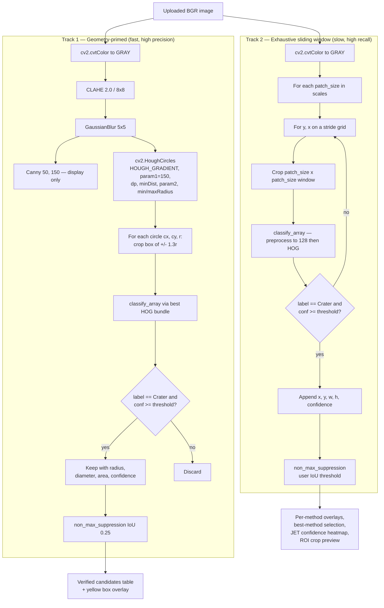

### 10.1 Track 1 — Hough-guided verification

A two-stage **propose-then-verify** cascade, the classical analogue of a
region-proposal detector:

1. **Propose.** Craters are approximately circular, so `cv2.HoughCircles` on the
   CLAHE+blur image is an extremely cheap, shape-specific proposal generator.
   It returns tens of candidates instead of thousands of windows.
2. **Verify.** Each proposal is expanded to a square-ish box of `±1.3r` — the
   same 1.30 scale factor used when the positive training patches were cut in
   Stage 1, so the verifier sees craters framed the way it was trained to see
   them — then classified. Only `Crater` predictions above the confidence
   threshold survive, and greedy NMS at IoU 0.25 removes concentric duplicates
   from the Hough accumulator.

Because candidates carry a radius, this track can report **physical geometry**
that the sliding window cannot: radius, diameter, and `pi * r^2` area in pixels.

The verifier is chosen as the HOG-bearing method with the highest
`test_accuracy` — i.e. the dashboard auto-selects its best available classifier
rather than hardcoding one.

The Canny edge map is produced for the four-panel stage strip
(`CLAHE → blur → Canny → candidates`) to make the pipeline legible; the Hough
transform itself runs on the blurred grayscale and performs its own internal
gradient computation, so the displayed Canny output is diagnostic, not an input.

### 10.2 Track 2 — Multi-scale sliding window

Brute-force dense scan, for recall and for method comparison:

- **Scales** — user-selected subset of `{64, 128, 192, 256}` (default
  `[128, 192]`), making the detector scale-aware despite a fixed-size classifier.
  Every window is resized to 128x128 by `preprocess_array` before HOG, so one
  model handles all scales.
- **Stride** — `max(32, min(96, max(scales) // 2))`, i.e. roughly half the
  largest window, clamped to `[32, 96]`. This couples step size to window size:
  large windows do not need fine steps, and the clamp bounds the worst case.
- **Thresholding** — a window is a detection only if the predicted label is
  `Crater` *and* `predict_proba` for that class clears the threshold.
- **NMS** — greedy, confidence-ranked, user-tunable IoU.

All four methods are run, then the "best method on this image" is chosen by
`(len(detections), mean(confidence))` — detection count first, mean confidence as
tiebreaker. This is a presentation heuristic for an unlabelled upload (no ground
truth exists to score against), not a statistical model-selection claim.

### 10.3 Non-maximum suppression

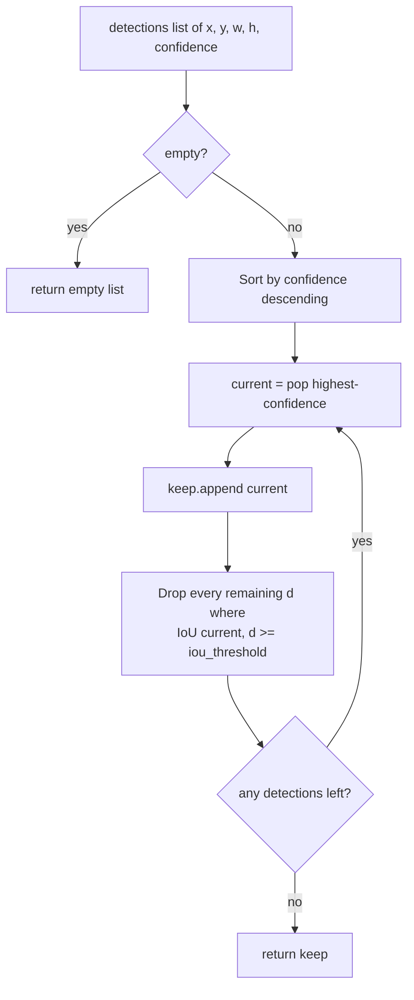

Standard greedy NMS over axis-aligned boxes, with `iou()` computing
`intersection / union` and guarding `union == 0`. Called with the user threshold
for the sliding window and a fixed `0.25` for Hough verification — tighter there
because the Hough accumulator reliably emits near-concentric duplicate circles.

### 10.4 Confidence heatmap

`build_heatmap` accumulates `confidence * 255` into a float32 canvas over each
surviving box, clips to `[0, 255]`, applies `COLORMAP_JET`, and alpha-blends at
`alpha = 0.45` over the original image. Overlapping high-confidence detections
therefore saturate toward red, producing a density-weighted view of crater
activity rather than a binary mask.

### 10.5 Track comparison

| Dimension | Track 1 — Hough + verify | Track 2 — sliding window |
| --- | --- | --- |
| Proposals per image | tens | hundreds to thousands per scale |
| Shape prior | strong, circular | none |
| Classifier calls | one per circle | one per window per scale |
| Reports geometry | yes — radius, diameter, area | no, box only |
| Scale handling | implicit via Hough radius range | explicit scale list |
| Failure mode | misses non-circular or degraded craters that Hough never proposes | slow; fires on crater-like texture anywhere |
| Models used | one, auto-selected best | all four, compared |
| NMS IoU | fixed 0.25 | user 0.10 – 0.80 |

---

## 11. Data contracts and shapes

### 11.1 On-disk formats

**YOLO label line** (`craters/<split>/labels/<stem>.txt`, one line per crater):

```
<class_id> <x_center> <y_center> <width> <height>     # all normalised to [0,1]
```

`yolo_to_box` discards `class_id` entirely — the project is single-class
("crater"), and the Moon/Mars distinction is carried by the filename, not the
class id.

**Patch file names** (`processed_dataset/<split>/<class>/`):

```
<source_stem>_crater_<NNN>.png     # positive, NNN = annotation index in the source label file
<source_stem>_non_<NNN>.png        # negative, NNN = sampling order
```

The source stem prefix is load-bearing: it is both the leakage-control unit and
the key used by `find_original_source_for_patch` to recover provenance.

### 11.2 Shape pipeline

| Stage | Representation | Shape / dtype |
| --- | --- | --- |
| Source image | grayscale scene | `(640, 640)` `uint8` |
| Annotation | normalised YOLO tuple | 5 floats |
| Denormalised box | pixel corners | `[x1, y1, x2, y2]` floats |
| Padded square ROI | pixel corners | `[x1, y1, x2, y2]` floats, square pre-clip |
| Saved patch | PNG on disk | `(128, 128)` `uint8` |
| Preprocessed patch | post CLAHE + blur | `(128, 128)` `uint8` |
| HOG vector | descriptor | `(1764,)` `float64` |
| LBP vector | normalised histogram | `(18,)` `float32` |
| `hog_lbp` vector | concatenation | `(1782,)` |
| Train design matrix | stacked features | `(534, 1764)` |
| Valid design matrix | stacked features | `(98, 1764)` |
| Test design matrix | stacked features | `(112, 1764)` |
| Single inference input | reshaped for sklearn | `(1, 1764)` |

### 11.3 In-memory structures

**Model bundle** — produced by `train.py` (as joblib) and by
`train_method_models()` (in memory):

```python
{
    "model":         sklearn.pipeline.Pipeline,   # StandardScaler -> SVC
    "feature_type":  "hog" | "lbp" | "hog_lbp",
    "use_clahe":     bool,
    "use_blur":      bool,
    "test_accuracy": float,                        # app.py only
}
```

**Detection record** — sliding window:

```python
{"x": int, "y": int, "w": int, "h": int, "confidence": float}
```

**Detection record** — Hough verification (superset, adds geometry):

```python
{"x": int, "y": int, "w": int, "h": int,
 "radius": float, "diameter": float, "size_px": float, "confidence": float}
```

Both share the `x/y/w/h/confidence` core, which is precisely why one
`non_max_suppression` and one `draw_detection_boxes` serve both tracks.

### 11.4 Constants reference

| Constant | Value | File | Meaning |
| --- | --- | --- | --- |
| `IMAGE_SIZE` | `128` | `prepare_dataset.py` | Saved patch side |
| `MIN_CRATER_SIDE` | `16` | `prepare_dataset.py` | Minimum annotation side in px; smaller boxes are dropped as unresolvable |
| `POSITIVE_PADDING` | `0.15` | `prepare_dataset.py` | Context margin per side, giving a 1.30x square |
| `NEGATIVE_IOU_LIMIT` | `0.02` | `prepare_dataset.py` | Max tolerated overlap of a negative with any annotation |
| `RANDOM_SEED` | `42` | `prepare_dataset.py` | Negative-sampling reproducibility |
| `VALID_EXT` | jpg, jpeg, png, bmp, tif, tiff | all loaders | Accepted image extensions |
| `IMG_SIZE` | `(128, 128)` | `features.py` | Classifier input size |
| `METHODS` | 4 tuples | `app.py` | Ablation configurations surfaced in the UI |
| `EXPERIMENTS` | 4 tuples | `experiment.py` | Same ablation, CLI form |

---

## 12. Runtime characteristics

### 12.1 Cost model

| Operation | Approximate cost | Notes |
| --- | --- | --- |
| `prepare_dataset.py` | O(images x (boxes + rejection attempts)) | Dominated by `cv2.imwrite`; seconds on the 24-image lunar subset |
| One feature extraction | one resize + CLAHE + blur + HOG | The unit cost of everything downstream |
| `train.py` | 744 extractions + one SVM fit with Platt scaling | `probability=True` triggers an internal cross-validation, the largest single cost |
| `experiment.py` | 4 x (646 extractions + fit) | Re-reads and re-extracts per configuration; no caching across rows |
| `app.py` cold start | 4 x (646 extractions + `probability=True` fit) | Paid once per process thanks to `@st.cache_resource` |
| Track 1 per upload | 1 Hough transform + ~tens of extractions | Interactive |
| Track 2 per upload | `4 methods x sum over scales of grid cells` extractions | The dominant interactive cost |

### 12.2 Sliding-window scaling

For a `W x H` image, window size `s` and stride `t`, the grid has
`floor((W-s)/t + 1) x floor((H-s)/t + 1)` positions. With the default
`scales = [128, 192]`, stride `= max(32, min(96, 192//2)) = 96`, and a 640x640
upload:

```
s=128:  floor((640-128)/96)+1 = 6  ->  6 x 6  =  36 windows
s=192:  floor((640-192)/96)+1 = 5  ->  5 x 5  =  25 windows
                                     total    =  61 windows per method
                                     x 4 methods = 244 feature extractions
```

Adding scale `64` or reducing the stride multiplies this quickly — a 32-pixel
stride at `s=64` alone is `19 x 19 = 361` windows per method. The stride formula
exists to keep that bounded, and it is the main knob if the upload branch feels
sluggish.

### 12.3 Caching and state

- `@st.cache_resource` on `train_method_models` — the only cache; keyed on
  nothing (no arguments), so it is effectively a process-lifetime singleton. It
  does **not** invalidate when `processed_dataset/` changes on disk; restart the
  Streamlit process after regenerating the dataset.
- No `st.session_state` is used. Every widget interaction re-runs the script top
  to bottom and recomputes all detections from scratch.
- `craters/*/labels.cache` files are Ultralytics YOLO label caches left over
  from the original dataset export. Nothing in this project reads them.

### 12.4 Determinism

| Source of randomness | Controlled how |
| --- | --- |
| Negative patch sampling | `random.Random(42)` instance threaded through all splits |
| SVM solver | `random_state=42` in `train.py` and `app.py` |
| Directory iteration order | `sorted()` at every listing site |
| `experiment.py` SVM | no `random_state` — for a linear SVC on this data the effect is negligible, but strict bit-reproducibility would require adding it |

---

## 13. Directory layout

```text
lunar_crater_cv_yolo_project/
│
├── craters/                              # INPUT — raw YOLO dataset (Moon + Mars)
│   ├── train/
│   │   ├── images/                       # 98 x 640x640 jpg  (16 lunar)
│   │   ├── labels/                       # 98 x YOLO .txt
│   │   └── labels.cache                  # Ultralytics leftover, unused here
│   ├── valid/
│   │   ├── images/                       # 26 images (4 lunar)
│   │   ├── labels/
│   │   └── labels.cache
│   └── test/
│       ├── images/                       # 19 images (4 lunar)
│       └── labels/
│
├── processed_dataset/                    # GENERATED — patch corpus (Stage 1 output)
│   ├── train/
│   │   ├── crater/                       # 267 x 128x128 png
│   │   └── non_crater/                   # 267
│   ├── valid/
│   │   ├── crater/                       #  49
│   │   └── non_crater/                   #  49
│   └── test/
│       ├── crater/                       #  56
│       └── non_crater/                   #  56
│
├── models/
│   └── lunar_crater_svm.joblib           # GENERATED — bundle: pipeline + preprocessing config
│
├── outputs/
│   ├── confusion_matrix.png              # GENERATED by train.py
│   └── annotated_sample.jpg              # GENERATED by visualize_yolo.py
│
├── prepare_dataset.py                    # Stage 1 — ETL
├── features.py                           # Stage 2 — shared preprocessing + descriptors
├── train.py                              # Stage 3 — train, evaluate, persist
├── experiment.py                         # Stage 4 — 4-way ablation table
├── app.py                                # Stage 5 — Streamlit dashboard
├── visualize_yolo.py                     # Utility — annotation sanity check
│
├── requirements.txt
├── README.md
└── architecture.md                       # this document
```

Generated directories (`processed_dataset/`, `models/`, `outputs/`) are fully
reproducible from `craters/` plus the scripts, and are safe to delete.

---

## 14. End-to-end execution runbook

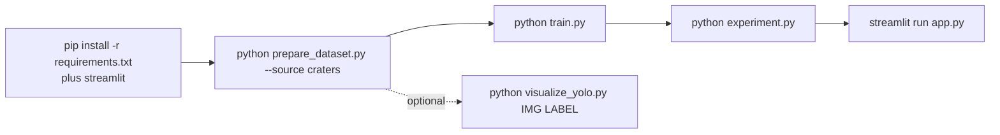

| Step | Command | Produces | Prerequisite |
| --- | --- | --- | --- |
| 0 | `pip install -r requirements.txt && pip install streamlit` | environment | — |
| 1 | `python prepare_dataset.py --source craters --output processed_dataset` | `processed_dataset/` (wipes any existing copy) | `craters/` present |
| 2 | `python train.py` | `models/lunar_crater_svm.joblib`, `outputs/confusion_matrix.png`, valid + test reports | step 1 |
| 3 | `python experiment.py` | ablation table on stdout | step 1 |
| 4 | `streamlit run app.py` | interactive dashboard | step 1 (step 2 not required) |
| — | `python visualize_yolo.py craters/test/images/.jpg craters/test/labels/.txt` | `outputs/annotated_sample.jpg` | `craters/` present |

**Dependency note.** `app.py` trains its own models and never reads
`models/lunar_crater_svm.joblib`, so step 4 depends on step 1 but not step 2.
Step 2 remains the canonical artifact producer for reporting.

---

## 15. Design decisions and rationale

| Decision | Alternative rejected | Why |
| --- | --- | --- |
| Convert detection labels into classification patches | Train a detector directly | Keeps the project within classical CV; a HOG+SVM patch classifier plus a proposal mechanism is the canonical pre-deep-learning detection architecture |
| Split at source-image granularity | Random patch-level split | Patches from one scene share terrain, lighting and compression; patch-level splitting would leak and inflate test scores |
| Mine negatives from the same image as positives | Use a separate "background" image pool | Forces discrimination of crater versus local terrain rather than scene-level shortcuts |
| Square, 1.30x-padded positive ROIs | Tight annotation crop | Retains the rim-shadow gradient pair that HOG depends on, and avoids aspect-ratio distortion at resize |
| Reject negatives at IoU > 0.02 | Higher threshold such as 0.3 | A near-zero threshold guarantees negatives are genuinely crater-free, including against annotations dropped for being tiny |
| Single shared `features.py` | Inline preprocessing per script | Eliminates train/serve skew by construction |
| Config flags `use_clahe` / `use_blur` and pluggable `feature_type` | Separate scripts per variant | Makes the ablation a data structure, so adding a fifth variant is one tuple |
| Persist a bundle, not a bare estimator | `joblib.dump(model)` | The preprocessing recipe is part of the model's contract; separating them invites silent mismatch |
| `StandardScaler` inside a `Pipeline` | Scale manually before fit | Scaler statistics are fitted on train only and travel with the model |
| Grayscale throughout | Keep BGR | Lunar optical imagery is effectively monochrome; colour adds 3x cost and no signal |
| Two detection tracks in the app | Only sliding window | Hough gives speed, precision and physical radius/area; sliding window gives recall and cross-method comparison. Showing both makes the precision/recall trade-off visible |
| `app.py` trains four models at startup | Load the single joblib artifact | The dashboard's purpose is side-by-side method comparison, which needs all four; `@st.cache_resource` amortises the cost |
| 1.30x expansion when verifying Hough circles | Crop at exactly radius r | Matches the framing the classifier was trained on in Stage 1 |

---

## 16. Known limitations and caveats

**Methodological**

1. **`app.py` selects its verifier using test-set accuracy.**
   `train_method_models()` scores every configuration on
   `processed_dataset/test`, and `verify_hough_candidates` is driven by the
   highest-scoring HOG method. The test split therefore participates in model
   selection inside the app, so the displayed accuracies are optimistic as
   generalisation estimates. `valid` exists for exactly this purpose and would
   be the correct split to select on. The offline numbers from `train.py` are
   unaffected.
2. **Very small corpus.** 24 lunar source images yield 744 patches, and only 4
   source images back the 112-patch test split. Confidence intervals on the
   reported metrics are wide, and a single unusual scene can move accuracy by
   several points.
3. **1764 features from 534 training samples.** p >> n. The linear kernel and
   `C=1.0` mitigate this — 174 of 534 samples end up as support vectors, which
   is a healthy margin — but the feature count is the practical ceiling on what
   this dataset can support.
4. **Lunar/Mars separation is filename-based.** `is_lunar_file` tests for the
   substring `mars_crater`. Any renamed or re-exported Martian file would be
   silently admitted as lunar.
5. **"Best method on this image"** in the upload branch ranks by detection count
   then mean confidence. With no ground truth for an upload this is a display
   heuristic, not evidence of superiority — a method that over-triggers will
   tend to win.

**Engineering**

6. **`streamlit` is missing from `requirements.txt`.** A fresh environment
   installed from the manifest cannot run `app.py`.
7. **No dataset-level `class_weight` risk, but no imbalance handling at the
   patch budget either.** If a crater-dense image exhausts `max_attempts`, that
   image contributes more positives than negatives; the corpus-wide balance then
   relies on `class_weight='balanced'` to compensate.
8. **`@st.cache_resource` never invalidates on data change.** Regenerating
   `processed_dataset/` requires restarting the Streamlit process.
9. **Dead resize in `detect_craters_in_image`.** The window is sliced as
   `patch_size x patch_size` and then conditionally resized to
   `(patch_size, patch_size)`; the guard can only fire at image borders, which
   the loop bounds already exclude. Harmless, but the real resize to 128x128
   happens later inside `preprocess_array`.
10. **Right and bottom edges are never scanned.** `range(0, dim - patch_size + 1, stride)`
    drops any trailing margin smaller than the stride, so craters hugging the
    right or bottom edge can be missed by Track 2.
11. **Hough `param1` is hardcoded to 150** while the other five Hough parameters
    are exposed as sliders — an inconsistency in the control surface.
12. **`experiment.py` has no `FileNotFoundError` guard.** Unlike `train.py` and
    `app.py`, it calls `iterdir()` directly and raises a raw OS error if the
    dataset has not been prepared.
13. **No automated tests, no CI, no logging framework.** Observability is
    `print()` and Streamlit panels.
14. **Repository hygiene.** `__pycache__/`, `.venv/`, `.DS_Store`, generated
    `processed_dataset/`, `models/` and `outputs/` are all present in the working
    tree, and the project is not under version control. A `.gitignore` covering
    these would be the first step toward tracking it.

---

## 17. Extension points

The architecture localises most plausible changes to a single site:

| Change | Touch point | Effort |
| --- | --- | --- |
| Add a new descriptor (e.g. Gabor, HuMoments, ORB-BoW) | `features.py`: add `extract_<x>` and a branch in `extract_features`, then add a tuple to `METHODS` / `EXPERIMENTS` | Low — the UI and ablation table pick it up automatically |
| Try an RBF or polynomial kernel | `train.py` / `experiment.py` / `app.py` pipeline definition | Low |
| Add hyperparameter search | Wrap the pipeline in `GridSearchCV` scored on `valid` inside `train.py` | Low |
| Change patch resolution | `IMAGE_SIZE` in `prepare_dataset.py` and `IMG_SIZE` in `features.py` must move together; HOG dimensionality changes accordingly | Low, but requires regenerating the dataset and retraining |
| Fix the app's model selection | Load `valid` in `train_method_models` and rank on validation accuracy | Low — closes caveat 1 |
| Include Mars imagery, or train a 3-class planet-aware model | `is_lunar_file` in `prepare_dataset.py`, plus the label mapping in every `load_split` | Medium |
| Add data augmentation (rotation, flips, gamma jitter) | New augmentation step inside `prepare_split` after `crop_and_resize`, or a transform layer in `load_split` | Medium — the corpus size is the dominant limitation, so this is the highest-leverage change |
| Speed up the sliding window | Cache per-image HOG once and slice block-wise instead of recomputing per window; or add an image-pyramid fast reject | Medium-high |
| Serve the model over HTTP instead of Streamlit | New FastAPI module that loads the joblib bundle and reuses `classify_array`; the bundle's self-describing fields make this safe | Medium |
| Report crater diameters in metres | Add a pixel-scale parameter and multiply `radius`/`diameter`/`size_px` in `verify_hough_candidates` | Low |
| Evaluate detection, not just classification | New module that matches Track 1/Track 2 output against `craters/test/labels` by IoU and computes detection precision/recall or mAP | High — this is the missing evaluation layer |

### Where the architecture would need to change

Two extensions do **not** fit the current shape and would require restructuring
rather than extension:

- **Multi-class crater typing** (simple / complex / degraded) would need new
  annotation semantics — Stage 1 currently discards the YOLO `class_id`
  entirely.
- **End-to-end learned detection** would replace Stages 2 and 3 wholesale and
  violate the project's no-deep-learning constraint; the patch corpus from
  Stage 1 would still be reusable as a pretraining or validation set.
